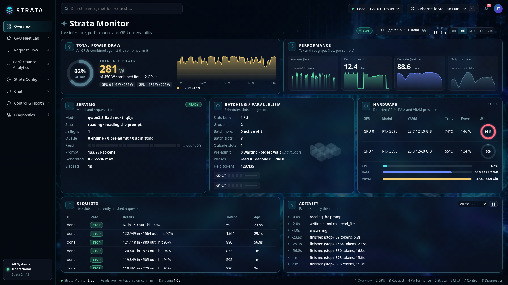
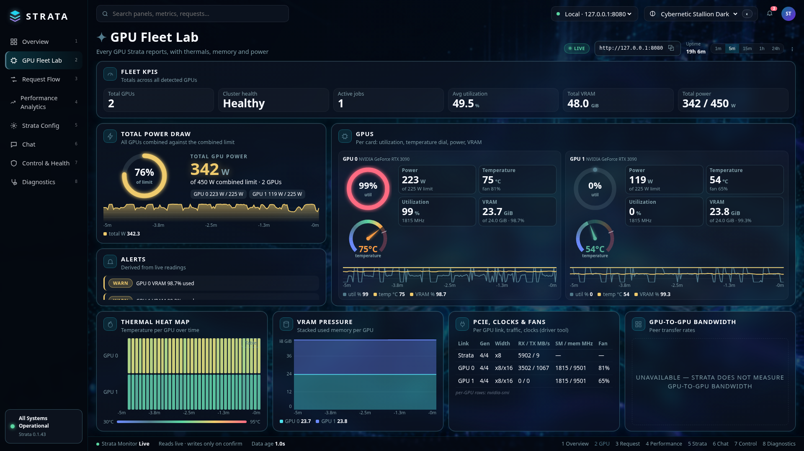
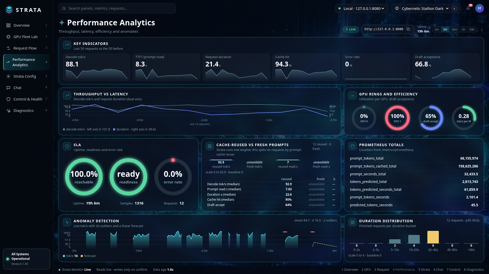
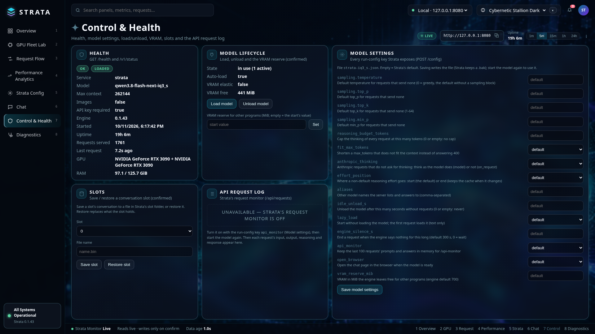
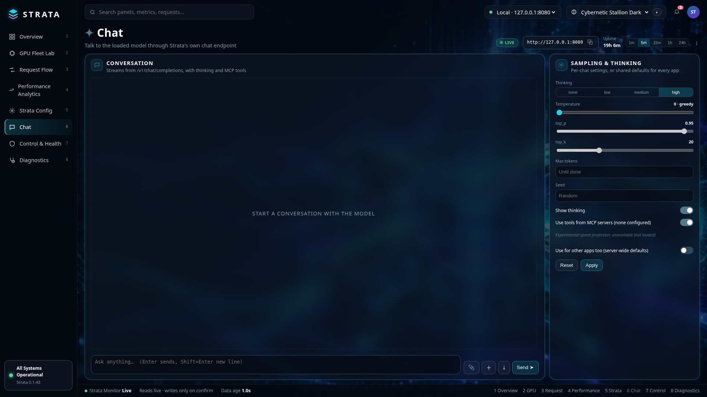

# Strata Monitor

A live dashboard, chat and control panel for a running [Strata](https://github.com/Niko1221/Strata) server.
It reads Strata's API directly (plus `nvidia-smi` for per-GPU details), keeps a short rolling history for charts,
and never invents data: anything Strata does not report is shown as *unavailable*.

> **Independent community tool.** Strata Monitor is not affiliated with, endorsed by, or supported by the Strata project.

Pages (hotkeys 1-8): Overview · GPU Fleet Lab · Request Flow · Performance Analytics · Strata Config · Chat ·
Control & Health · Diagnostics. 14 light and dark themes.

## Screenshots

| Overview | GPU Fleet Lab |
|---|---|
|  |  |
| **Performance Analytics** | **Control & Health** |
|  |  |
| **Chat** | |
|  | |

## Requirements

- Python 3.8+ (standard library only, nothing to `pip install`)
- A running Strata server and its API key
- A modern browser
- Optional: `nvidia-smi` on PATH for per-GPU PCIe, clocks and fans; a local Strata folder for Diagnostics

## Install

Download `strata-monitor-v1.0.0.zip` from the [Releases](../../releases) page, then:

```sh
unzip strata-monitor-v1.0.0.zip && cd strata-monitor
STRATA_API_KEY=yourkey python3 strata_monitor.py
```

Open <http://127.0.0.1:8090/>.

Alternatively, save your settings once with `STRATA_API_KEY=yourkey ./install.sh` (writes `strata-monitor.json`,
mode 600) and start with `./run.sh` afterwards. On Windows: `run.bat --key yourkey --strata-dir "C:\Strata"`.

## Configuration

| Flag | Env var | Default | Meaning |
|---|---|---|---|
| `--key` | `STRATA_API_KEY` | *(required)* | Strata API key |
| `--strata-url` (alias `--strata`) | `STRATA_URL` | `http://127.0.0.1:8080` | Strata base URL |
| `--strata-dir` | `STRATA_DIR` | *(empty)* | Strata install folder; only needed for **Run Diagnostics** (`setup.py --check`) |
| `--host` | | `127.0.0.1` | Listen address. Use `0.0.0.0` only on a trusted network |
| `--port` | | `8090` | Listen port |
| `--interval` | | `2.0` | Sampling interval in seconds |
| `--config` | | | JSON settings file (as written by `install.sh`); command-line flags win |

## Connecting to Strata

1. Start Strata as usual and note its address (default `http://127.0.0.1:8080`) and API key.
2. Run the monitor with `--strata-url` pointing at that address and the key in `--key` or `STRATA_API_KEY`.
3. The sidebar shows **All Systems Operational** once Strata answers; otherwise each panel shows *unavailable*.

The monitor forwards only Strata's read endpoints plus the write calls Strata's own pages make (chat, model
settings, shared defaults, load/unload, VRAM reserve, slot save/restore), each from a button you press and
confirmed first. Every POST needs a per-run token embedded in the served page and a same-origin `Origin`.
Diagnostics only builds a GitHub issue *preview*; nothing is ever posted automatically.

## Optional: systemd user service

`~/.config/systemd/user/strata-monitor.service`:

```ini
[Unit]
Description=Strata Monitor
After=network-online.target

[Service]
WorkingDirectory=%h/strata-monitor
Environment=STRATA_API_KEY=yourkey
Environment=STRATA_URL=http://127.0.0.1:8080
ExecStart=/usr/bin/python3 strata_monitor.py --port 8090
Restart=on-failure
RestartSec=5

[Install]
WantedBy=default.target
```

```sh
systemctl --user daemon-reload
systemctl --user enable --now strata-monitor
```

(For tighter key handling use `EnvironmentFile=` pointing at a mode-600 file.)

## License

MIT, see [LICENSE](LICENSE).
